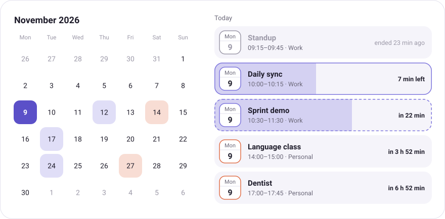
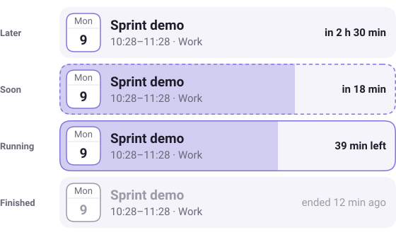
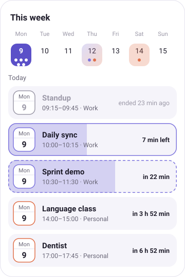
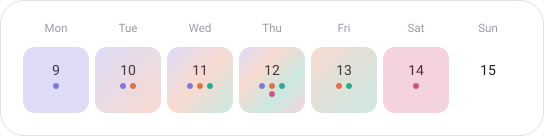
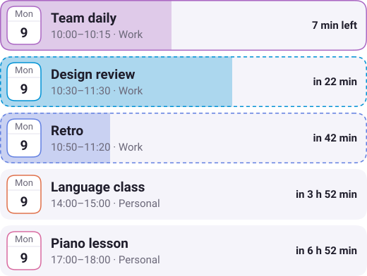
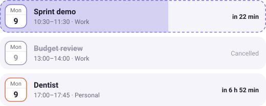
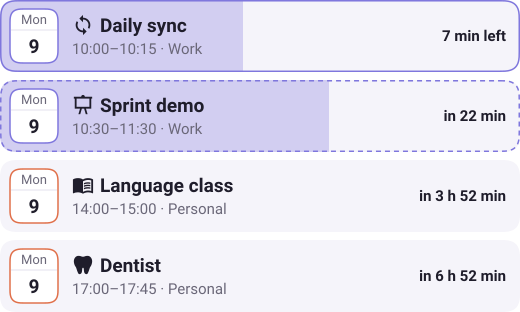
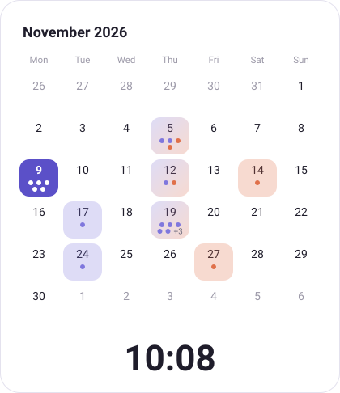
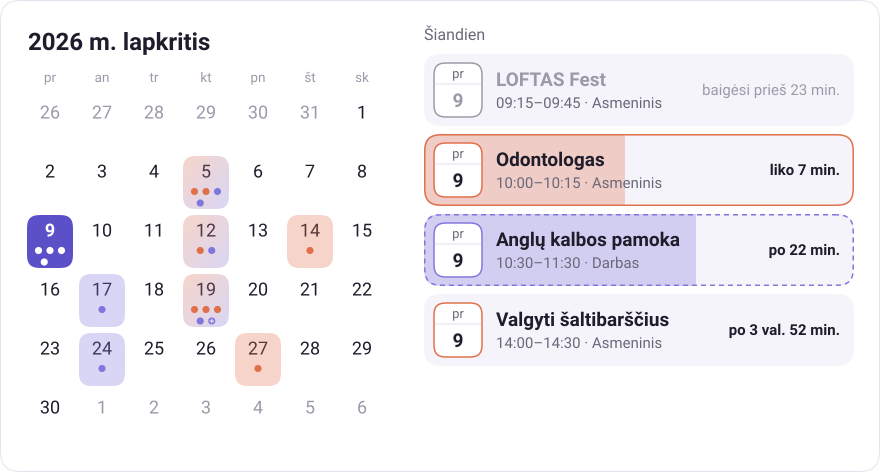

<div align="center">

# Eventide

**A Home Assistant calendar card where events rise before they start and ebb while they run.**

[](https://github.com/kriakiku/eventide-card/actions/workflows/ci.yml)
[](LICENSE)




</div>

> [!IMPORTANT]
> Eventide is young and the configuration can still change between releases. The images on this page are design previews from [a script](scripts/render-docs.ts): the card images use the output of the real core, and the animation is drawn by hand.

## Install

**With HACS.** Open HACS, choose the three dots in the top corner and then **Custom repositories**. Add `https://github.com/kriakiku/eventide-card` with the type **Dashboard**, then find Eventide in HACS and download it.

**By hand.** Download `eventide-card.js` from the [latest release](https://github.com/kriakiku/eventide-card/releases/latest), put it in your `www` folder and add `/local/eventide-card.js` as a JavaScript module under your dashboard resources.

Then add the card from the card picker. It has a visual editor for everything except `translations` and `cancelled_match`, which are set in YAML.

## The idea

Most calendar cards tell you what is on your calendar. Eventide shows you how close it is.

Every event row is its own progress bar. As a meeting approaches, the row fills up like a rising tide. When it starts, the row is full, and it drains as the time runs out. You can read the state of your day from across the room, without reading a single number.

<p align="center">
  
</p>

## Four states, one row

<table>
<tr>
<td width="58%">

</td>
<td>

**Later.** A quiet row with the time left until the start.

**Soon.** A dashed outline, and the fill rises during the lead time, one hour by default.

**Running.** A solid outline, and the fill drains until the end.

**Finished.** Dimmed, and a timed event stays for 30 more minutes, so you can still see what you just left.

</td>
</tr>
</table>

A row keeps the same height in every state, so the list doesn't jump when an event changes state.

## Fits the screen it's on

<table>
<tr>
<td align="center" width="40%">

</td>
<td>

The layout follows the width of the card rather than the device:

- **Wide:** the month grid next to the agenda.
- **Medium:** the month grid above the agenda.
- **Narrow:** a week strip above the agenda, for phones and wall panels.

When the agenda is longer than the card, its top and bottom edges fade out smoothly wherever there is more to scroll to.

It's meant to be light enough for a low-powered wall tablet. The card runs no continuous animations, and one timer recalculates the states every 30 seconds without touching the network.

</td>
</tr>
</table>

## The month at a glance

A day with events is tinted in the color of its calendar. When several calendars share a day, their colors blend into a gradient, so a mixed day is easy to tell apart.

<p align="center">
  
</p>

Each event also gets a dot in its calendar's color. Three dots sit in the first row, and the fourth and fifth tuck in between them below. Past five events, the fifth place becomes a plus in a circle tinted with the colors of the events that didn't fit, so a busy day never reaches the edges of its cell.

## Colors for recurring events

Turn on `series_colors` to give each recurring event its own shade. The shade is a small hue shift around the calendar's color, so your daily and your weekly look different but still belong together. It comes from the event's identifier, or its title if it has none, so a meeting keeps the same color every time.

<p align="center">
  
</p>

## Cancelled events

A cancelled event stays visible for a while, so you know the slot is free, but it doesn't crowd the list. It's struck through, has no fill or countdown, and isn't counted in `limit` or in the calendar grid.

<p align="center">
  
</p>

It appears the day before and disappears when it would have started. Events further ahead stay hidden, and a day you pick in the grid shows everything.

Outlook marks a cancelled meeting with a prefix in its title, such as `Canceled:`, and the card recognizes that in several languages. Use `cancelled_match` to set your own pattern, or set it to `""` to turn detection off, and use `show_cancelled: false` to hide these events.

Home Assistant currently removes events with a cancelled status before they reach any card, so Google Calendar cancellations can't be shown.

## Icons

Give events an icon with `rules`. It appears before the title, and it's picked by matching the title.

<p align="center">
  
</p>

```yaml
type: custom:eventide-card
calendars:
  - calendar.work
  - calendar.personal
rules:
  - match: daily
    icon: mdi:sync
  - match: demo|review
    icon: mdi:presentation
  - match: language|class
    icon: mdi:book-open-variant
  - match: dentist
    icon: mdi:tooth
```

`match` is a case-insensitive regular expression, and `exact` matches a whole title. You can use any icon Home Assistant knows, including the `mdi:` set and icons from custom integrations.

## Renaming events

Long or noisy titles can be replaced with your own through `rules`. Use `exact` for a title that must match completely, including case, and `match` for a case-insensitive regular expression. The whole title is replaced, and `$1` to `$9` insert what the groups in `match` captured.

```yaml
type: custom:eventide-card
calendars:
  - calendar.work
rules:
  - exact: Weekly sync with the platform team
    title: Platform sync
  - match: "^Project (\\w+) review"
    title: $1 review
    icon: mdi:presentation
```

Rules always look at the original title, and the first rule that sets a title wins. A renamed event keeps its place, its color and its identity for `series_colors`.

## Optional clock

Turn on `show_clock` to put the current time under the calendar, centered in the free space. It's off by default and follows your 12 or 24-hour setting.

<p align="center">
  
</p>

## Details that are already handled

The core is pure TypeScript with no runtime dependencies. It's covered by tests across time zones that are hard to get right, such as those with a DST change at midnight or a 30-minute shift.

- **Time zones:** days are computed in your Home Assistant time zone, not the browser's.
- **Both Home Assistant formats:** it reads the REST and the websocket event shapes.
- **Overnight events:** a 23:30–00:30 meeting behaves like any other meeting.
- **All-day and long events:** anything all-day or 24 hours and longer sits in its own group, with no fill.
- **Overlaps:** events at the same time are all kept.
- **Duplicates:** the same event in two calendars is shown once.
- **Rules:** case-insensitive patterns set icons and colors by event title, including in Cyrillic. An invalid pattern is reported, not fatal.

## Languages and translations

The card follows the language of your Home Assistant profile.

- **Weekdays and months** always come from the browser, in any language.
- **English** uses its own wording, such as `in 3 h 52 min`, `7 min left` and `ended 23 min ago`.
- **Other languages** use the browser for "today" and relative times, such as `через 4 год`. It only knows one unit at a time, so anything over an hour is rounded to hours.
- **A few labels**, such as "All day", have no browser equivalent. They exist in English and Ukrainian and fall back to English elsewhere.

You can replace any of this with the `translations` option, for one language or for several. Set only the keys you want to change and the rest keep their defaults. A key under `pt-BR` wins over the same key under `pt`.

Here is a full translation into Lithuanian:

```yaml
type: custom:eventide-card
calendars:
  - calendar.work
translations:
  lt:
    today: Šiandien
    tomorrow: Rytoj
    all_day: Visą dieną
    cancelled: Atšaukta
    empty: Artimiausių įvykių nėra
    free_day: Šią dieną laisva
    starts_in: po {time}
    time_left: liko {time}
    ended_ago: baigėsi prieš {time}
    just_ended: ką tik baigėsi
    minutes: '{n} min.'
    hours: '{n} val.'
```

That gives `po 3 val. 52 min.`, `liko 7 min.` and `baigėsi prieš 23 min.`.

<p align="center">
  
</p>

| Key          | English             | Placeholder | Used for                          |
| ------------ | ------------------- | ----------- | --------------------------------- |
| `today`      | Today               |             | The heading for today's events    |
| `tomorrow`   | Tomorrow            |             | The heading for tomorrow's events |
| `all_day`    | All day             |             | The time of an all-day event      |
| `cancelled`  | Cancelled           |             | A cancelled event                 |
| `empty`      | Nothing coming up   |             | An empty agenda                   |
| `free_day`   | Nothing on this day |             | A picked day with no events       |
| `starts_in`  | in {time}           | `{time}`    | An event that hasn't started      |
| `time_left`  | {time} left         | `{time}`    | A running event                   |
| `ended_ago`  | ended {time} ago    | `{time}`    | A finished event                  |
| `just_ended` | just ended          |             | Under a minute after the end      |
| `minutes`    | {n} min             | `{n}`       | The minutes inside `{time}`       |
| `hours`      | {n} h               | `{n}`       | The hours inside `{time}`         |

Setting `starts_in` or `ended_ago` also switches that phrase to exact hours and minutes.

## Configuration

> [!NOTE]
> Until 1.0 the configuration may change between releases.

```yaml
type: custom:eventide-card
view: auto
lead_time: 60
linger: 30
limit: 5
calendars:
  - entity: calendar.work
    color: '#7F77DD'
  - entity: calendar.personal
    color: '#E0704A'
rules:
  - match: 'demo|review'
    icon: mdi:presentation
  - match: 'dentist|doctor'
    icon: mdi:stethoscope
    color: '#E0704A'
```

| Option            | Default         | Description                                                                                                     |
| ----------------- | --------------- | --------------------------------------------------------------------------------------------------------------- |
| `calendars`       | none            | The calendar entities to show, each with an optional `color`.                                                   |
| `view`            | `auto`          | `auto`, `month`, `week` or `none` to show only the agenda.                                                      |
| `lead_time`       | `60`            | Minutes before the start when the row begins to fill. `0` disables.                                             |
| `linger`          | `30`            | Minutes a finished timed event stays in the list. `0` disables.                                                 |
| `limit`           | `5`             | How many timed events to show. Finished ones count.                                                             |
| `dedupe`          | `true`          | Show an event found in several calendars only once.                                                             |
| `first_weekday`   | your HA setting | First day of the week: `monday` to `sunday`, or `language`.                                                     |
| `time_format`     | your HA setting | `24`, `12` or `language`.                                                                                       |
| `today_color`     | theme primary   | The color of the current day in the grid.                                                                       |
| `show_clock`      | `false`         | Show the current time under the calendar.                                                                       |
| `show_navigation` | `true`          | Show the buttons that switch months or weeks.                                                                   |
| `series_colors`   | `false`         | Give each recurring event its own shade of the calendar color.                                                  |
| `translations`    | none            | Custom wording per language, see [Languages and translations](#languages-and-translations).                     |
| `show_cancelled`  | `true`          | Show recognized cancelled events.                                                                               |
| `cancelled_match` | common prefixes | The pattern that marks an event as cancelled, `""` to turn it off.                                              |
| `rules`           | none            | Set `icon`, `color` and `title` by event title, first match per field. See [Renaming events](#renaming-events). |

## Roadmap

- [x] Time and state core with tests
- [x] Live data from Home Assistant, with a REST fallback
- [x] The card: month grid, week strip, agenda and responsive layouts
- [x] Any language through the browser, with custom translations
- [x] First release
- [x] Visual editor
- [x] HACS support as a custom repository
- [ ] Listing in the default HACS store

## Development

You need [mise](https://mise.jdx.dev), which installs the pinned Bun version.

```sh
mise install
bun install
bun run check        # format, lint, types, tests and build
bun run docs:images  # redraw the images in docs/
```

```text
src/eventide-card.ts  the card element
src/card/        config, translations and the live data feed
src/core/        pure logic: nothing reads the clock or the system time zone
  normalize.ts   Home Assistant events to one internal form
  phase.ts       later, soon, running, finished and the fill
  agenda.ts      filtering, ordering, grouping and limits
  grid.ts        month and week grids
  rules.ts       icons and colors by title
  timezone.ts    day arithmetic built on Intl
scripts/         the generator for the README images
```

## License

[MIT](LICENSE)
